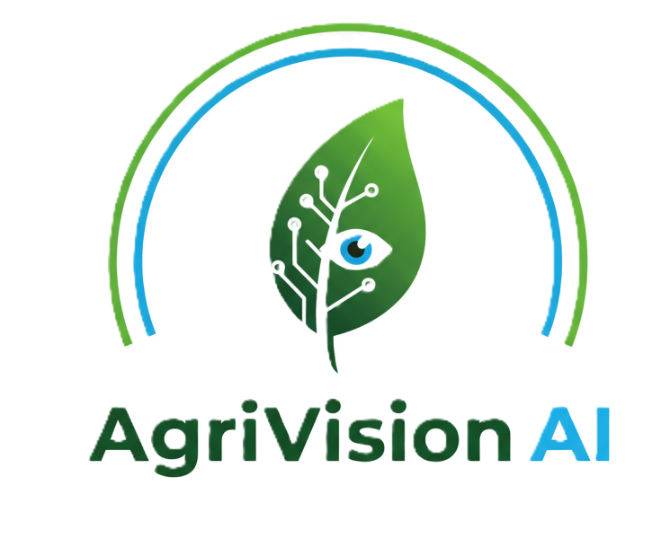
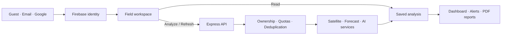

<div align="center">



# AgriVision AI

### Know your fields. Analyze when you need to.

A full-stack farm analysis platform with satellite imagery, crop forecasts, soil monitoring, and AI-assisted insights.

[](https://github.com/mukulkatewa/farmAnalysis/actions/workflows/checks.yml)


[**Open the app →**](https://farm-analysis-zeta.vercel.app) · [**Continue as guest**](https://farm-analysis-zeta.vercel.app/register) · [**API**](https://farm-analysis-api.vercel.app)

</div>

---

## Live application

| Service | Production URL |
|---|---|
| Web app | [farm-analysis-zeta.vercel.app](https://farm-analysis-zeta.vercel.app) |
| Backend API | [farm-analysis-api.vercel.app](https://farm-analysis-api.vercel.app) |
| Signup and guest access | [Create an account or continue as guest](https://farm-analysis-zeta.vercel.app/register) |

**Get started without Google or email:** choose **Continue as guest** to create a real Firebase anonymous workspace. You can add an email/password or Google sign-in later while keeping the same user ID, fields, and saved analysis. Keep access across devices by upgrading before signing out or clearing browser storage.

## What you can do

| Capability | How it works |
|---|---|
| **Manage your fields** | Draw field polygons, save multiple fields, and switch between workspaces. |
| **Inspect vegetation** | Generate polygon-masked NDVI, NDRE, SAVI, and EVI heatmaps from Sentinel-2 reflectance. |
| **Request forecasts** | Run crop-risk and stress analysis explicitly for the selected field. |
| **Explore analytics** | View weather, vegetation trends, water-stress indicators, and historical charts. |
| **Get AI explanations** | Request short insights or ask the Kisan Mitra assistant for farming guidance. |
| **Monitor soil readings** | Read field-scoped sensor records from Firebase Realtime Database. |
| **Scan crop images** | Submit JPEG/PNG images to the configured disease and pest services. |
| **Export reports** | Download PDFs assembled from saved analysis snapshots. |
| **Connect with vendors** | Browse service listings and use participant-scoped conversations. |

The interface includes English, Hindi, and Bengali translations.

## Analysis stays under your control

Opening the dashboard reads saved results. Fresh processing starts through an explicit action:

1. **Analyze** creates an analysis or reuses a fresh saved result.
2. **Refresh** requests a new analysis deliberately.
3. **Explain alerts with AI** generates explanations separately.
4. **Export report** uses saved snapshots without starting satellite or model processing.

Snapshots carry timestamps, geometry identity, and a freshness window. Missing results remain unavailable until you request analysis. Disease-risk values are displayed as model scores; NDVI is used as a vegetation index.

### Access and usage controls

- Firebase-verified identities for guests and registered users.
- Server-side field ownership checks and protected saved results.
- Shared daily quotas, concurrency limits, and idempotent requests.
- Guest limits that include a shared budget across anonymous identities.
- Bounded uploads, provider deadlines, and validated response contracts.

Defaults are **3 paid operations per guest per UTC day**, **20 per registered user**, **50 across all guests**, and **500 globally**. These are operation limits, not currency budgets; provider costs vary by operation. Configuration and deployment requirements are documented in [HARDENING.md](HARDENING.md).

## Architecture



| Layer | Technology |
|---|---|
| Frontend | React 19, Vite 7, Tailwind CSS 4 |
| Maps and charts | Leaflet, React Leaflet, Recharts |
| API | Express, Node.js 22, Firebase Admin |
| Authentication | Firebase email/password, Google, anonymous authentication |
| Storage | Firestore snapshots and Firebase Realtime Database sensor readings |
| Satellite processing | Copernicus Sentinel-2 L2A reflectance and polygon masking |
| AI and models | Groq explanations/chat and external forecast, disease, and pest services |
| Hosting | Separate frontend and API projects on Vercel |

The externally hosted model services are configured through backend environment variables; their implementations are outside this repository.

## Run locally

### Prerequisites

- **Node.js 22** and npm.
- A Firebase project with Authentication and Firestore enabled.
- Enable **Anonymous**, **Email/Password**, and **Google** providers for the sign-in methods you intend to use.
- Provider credentials for satellite, AI, weather, or model features you want to enable.
- **Java 21** only if running Firebase emulator checks.

### 1. Clone and install

```sh
git clone https://github.com/mukulkatewa/farmAnalysis.git
cd farmAnalysis
npm --prefix backend ci
npm --prefix frontend ci
```

### 2. Configure the environment

Copy the templates and fill in your project values:

```sh
cp backend/.env.example backend/.env
cp frontend/.env.example frontend/.env
```

For the local API connection, set:

```dotenv
# backend/.env
PORT=5001
NODE_ENV=development

# frontend/.env
VITE_API_BASE_URL=http://localhost:5001/api
```

| Configuration | Where |
|---|---|
| Browser Firebase app configuration | `frontend/.env` — `VITE_FIREBASE_*` |
| Optional Maps and weather configuration | `frontend/.env` — `VITE_GOOGLE_MAPS_API_KEY`, `VITE_OPENWEATHER_API_KEY` |
| Firebase Admin credentials | `backend/.env` — `FIREBASE_PROJECT_ID`, `FIREBASE_CLIENT_EMAIL`, `FIREBASE_PRIVATE_KEY` |
| Satellite OAuth credentials | `backend/.env` — `SENTINEL_CLIENT_ID`, `SENTINEL_CLIENT_SECRET` |
| AI explanations and chat | `backend/.env` — `GROQ_API_KEY`, optional `GROQ_MODEL` |
| External model endpoints | `backend/.env` — `LSTM_API_URL`, `COLLECTOR_API_URL`, `DISEASE_API_URL`, `PEST_API_URL` |
| Usage limits and optional notification delivery | See [HARDENING.md](HARDENING.md) |

**Keep server credentials in the backend.** Vite embeds `VITE_*` values into the browser build; AI provider keys and Firebase Admin private keys do not belong there. Local `.env` files and Vercel credentials are excluded from Git.

### 3. Start both apps

In one terminal:

```sh
npm --prefix backend run dev
```

In another:

```sh
npm --prefix frontend run dev
```

Open **[localhost:5173](http://localhost:5173)**. With the configuration above, the API runs at **[localhost:5001](http://localhost:5001)**.

## Repository guide

```text
farmAnalysis/
├── frontend/
│   ├── src/
│   │   ├── components/       # Authentication, dashboard, maps, and chat
│   │   ├── pages/            # Analytics, alerts, reports, sensors, vendors
│   │   ├── firebase/         # Sign-in and guest-to-account linking
│   │   ├── api/              # Authenticated API client
│   │   └── hooks/            # Explicit analysis and saved-result loading
│   ├── tests/                # Unit and component behavior checks
│   └── browser-tests/        # Guest journey checks for local emulators
├── backend/
│   ├── api/index.js          # Vercel function entry
│   ├── src/
│   │   ├── controllers/      # Analysis, reporting, profiles, notifications
│   │   ├── services/         # Persistence, quotas, providers, vegetation
│   │   └── middleware/       # Firebase token verification
│   ├── scripts/              # Deployment configuration helpers
│   └── tests/                # API, quota, geometry, and emulator checks
├── .github/workflows/        # CI
├── firestore.rules           # Firestore access controls
├── database.rules.json       # Realtime Database access controls
└── firebase.test.json        # Local demo-project emulator settings
```

## Development checks

Run the checks you need:

```sh
npm --prefix backend test
npm --prefix frontend test
npm --prefix frontend run lint -- --max-warnings=0
npm --prefix frontend run build
```

Firebase rule checks use a local demo project and require Java 21:

```sh
npm --prefix backend run test:rules
```

For the guest browser journey, install Playwright's Chromium browser and run:

```sh
cd frontend
npx playwright install chromium
cd ..
npm --prefix backend run test:guest-ui
```

GitHub Actions runs unit checks, Firebase rule checks, dependency audits, lint, and the production build. Paid provider calls and real notification delivery are excluded from the automated checks.

## Deployment and operations

The current release is hosted as two Vercel projects:

| Project | Folder | Purpose |
|---|---|---|
| `farm-analysis` | `frontend/` | Vite web app |
| `farm-analysis-api` | `backend/` | Authenticated Express API |

See [DEPLOYMENT_NOTES.md](DEPLOYMENT_NOTES.md) for the production URLs, runtime compatibility setting, environment configuration, and deployment commands.

Sensor writers must use `users/{uid}/fields/{fieldId}/soil/{readingId}`. Existing shared sensor records need a reliable ownership mapping before migration. Notifications require a configured webhook, explicit consent, and a verified account contact.

## Documentation

- [Deployment notes](DEPLOYMENT_NOTES.md) — production setup and update commands.
- [Hardening and operations](HARDENING.md) — limits, API contracts, access controls, and rollout requirements.
- [Codebase review](CODEBASE_REVIEW.md) — original findings and their resolution status.
- [Frontend guide](frontend/README.md) · [Backend guide](backend/README.md).

---

<div align="center">
Built for a clearer view of the field.<br/>
<a href="https://farm-analysis-zeta.vercel.app"><strong>Explore AgriVision AI →</strong></a>
</div>

